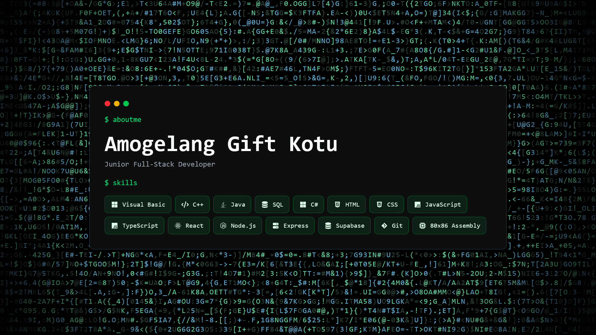

# Amogelang Kotu's Portfolio

This is a personal portfolio website built with React, TypeScript, and Vite. It showcases my projects and skills, with a focus on creating a unique and engaging user experience through the use of animations and interactive elements.

## Live Demo

[](https://agkotu-portfolio-2w4s.vercel.app/)

## Features

- **Fully Responsive:** Looks great on desktops, tablets, and mobile devices.
- **Modern UI/UX:** Clean, minimal, and accessible design.
- **Fast & Optimized:** Built for performance with optimized assets and best practices.
- **Functional Contact Section:** The email and social media links navigate to their respective pages.
- **Downloadable CV:** My current CV document is available for download.

## Technologies Used

- [React](https://reactjs.org/)
- [TypeScript](https://www.typescriptlang.org/)
- [Vite](https://vitejs.dev/)
- [Tailwind CSS](https://tailwindcss.com/)

## Installation

1. Clone the repository:

   ```bash
   git clone https://github.com/4amogelangkotu/agkotu-portfolio.git
   ```

2. Navigate to the project directory:

   ```bash
   cd agkotu-portfolio
   ```

3. Install the dependencies:

   ```bash
   npm install
   ```

## Available Scripts

In the project directory, you can run:

### `npm run dev`

Runs the app in the development mode.
Open [http://localhost:5173](http://localhost:5173) to view it in the browser.

The page will reload if you make edits.
You will also see any lint errors in the console.

### `npm run build`

Builds the app for production to the `dist` folder.
It correctly bundles React in production mode and optimizes the build for the best performance.

The build is minified and the filenames include the hashes.
Your app is ready to be deployed!

### `npm run lint`

Lints the project files using ESLint.

### `npm run preview`

Serves the production build locally.

## File Structure

``` text
.
├── public
│   ├── og-image.png
│   ├── ts-logo.png
│   ├── uj-logo.png
│   └── vite.svg
├── src
│   ├── assets
│   │   ├── at, bt, sc, tsd    # per-project logos and gallery screenshots
│   │   └── a-logo.svg
│   ├── components
│   │   ├── sections
│   │   │   ├── Contacts.tsx
│   │   │   ├── Education.tsx
│   │   │   ├── Header.tsx
│   │   │   └── Projects.tsx
│   │   ├── ui
│   │   │   ├── avatar.tsx
│   │   │   ├── button.tsx
│   │   │   ├── border-trail.tsx
│   │   │   └── timeline-steps.tsx
│   │   ├── Description.tsx
│   │   ├── LetterGlitch.tsx
│   │   ├── ShinyText.tsx
│   │   ├── skillIcons.ts
│   │   └── TerminalWindowBar.tsx
│   ├── data
│   │   └── projectsData.tsx
│   ├── lib
│   │   └── utils.ts
│   ├── pages
│   │   ├── projects
│   │   │   ├── AThrifters.tsx
│   │   │   ├── BenchmarkTrader.tsx
│   │   │   └── TrafficSignDetector.tsx
│   │   ├── EducationPage.tsx
│   │   └── NotFoundPage.tsx
│   ├── App.css
│   ├── App.tsx
│   ├── index.css
│   ├── main.tsx
│   └── routes.ts
├── .gitignore
├── index.html
├── package.json
├── README.md
└── vite.config.ts
```

## Contact Me

I'd love to hear from you!

- **Email:** [amogelangkotu@icloud.com](mailto:amogelangkotu@icloud.com)
- **LinkedIn:** [in/amogelangkotu](https://www.linkedin.com/in/amogelangkotu/)
- **Twitter:** [@giftamogelangg](https://twitter.com/giftamogelangg)
